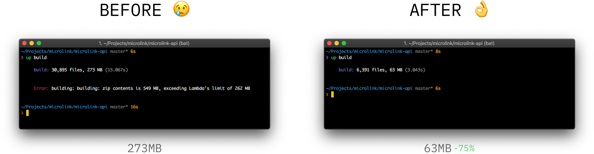

<div align="center">
  <br>
  <h3 align="center">untracked</h3>
  
  <br><br>
  <a href="https://www.npmjs.org/package/untracked"></a>
  <a href="https://www.npmjs.org/package/untracked"></a>
  <br><br>
  Universal way for ignoring unnecessary common files to create the smallest production bundle possible.
  <br><br>
</div>

**untracked** generates ignore patterns for files you don't need in production: documentation, config files, source maps, type definitions, test files, and more: using [gitignore pattern format](https://git-scm.com/docs/gitignore#_pattern_format), making it compatible with any tool that supports ignore files.

## Install

```bash
npm install untracked -g
```

## Usage

```
npx untracked
```

The files to ignore will be detected automagically.

### Write to a file

Redirect the output to any ignore file:

```bash
npx untracked > .dockerignore
npx untracked > .slugignore
npx untracked > .vercelignore
```

### Update in place

If you already have an ignore file with custom rules, use `--write` to update only the auto-generated section (between `### start` and `### finished` markers) while preserving everything else:

```bash
npx untracked --write .dockerignore
```

### Platform examples

**Heroku**: write as [`.slugignore`](https://devcenter.heroku.com/articles/slug-compiler#ignoring-files-with-slugignore) during prebuild:

```json
{
  "scripts": {
    "heroku-prebuild": "npx untracked > .slugignore"
  }
}
```

**Vercel**: write as [`.vercelignore`](https://vercel.com/docs/concepts/deployments/vercel-ignore):

```bash
npx untracked > .vercelignore
```

**Docker**: write as [`.dockerignore`](https://docs.docker.com/engine/reference/builder/#dockerignore-file):

```bash
npx untracked > .dockerignore
```

**Yarn**: clean up `node_modules` via [`.yarnclean`](https://yarnpkg.com/en/docs/cli/autoclean):

```bash
yarn install --production
npx untracked > .yarnclean
yarn autoclean --force
```

### Prune an installed `node_modules`

Ignore files only filter what gets copied. When dependencies are installed inside the image or bundle (`RUN npm ci` in a Dockerfile), run `prune` after the install instead:

```bash
npx untracked prune            # defaults to ./node_modules
npx untracked prune --dry-run  # list what would go, delete nothing
```

It deletes files no production code reads: source maps (`*.map`), type definitions (`*.d.ts`, `*.d.mts`, `*.d.cts`), Flow sources (`*.flow`), and readmes, changelogs, histories, authors, contributors and code of conduct files in any markup format. It matches file names only, so directories, dotfiles and licenses are never deleted, and it never follows symlinks, so it is safe on pnpm's `.pnpm` layout.

`typescript/lib` is always kept, because the TypeScript compiler reads its `.d.ts` files at runtime. Keep any other directory or file with `--keep`, repeated as needed. A relative path matches wherever it appears in the tree, so `my-pkg/types` also covers pnpm's `.pnpm/my-pkg@1.0.0/node_modules/my-pkg/types`; an absolute path matches only itself:

```bash
npx untracked prune node_modules --keep my-pkg/types --keep other-pkg/index.d.ts
```

Unknown flags are rejected before anything is deleted. A file or directory it cannot read or delete is reported on stderr, the rest of the tree is still pruned, and the command exits with `1`.

In a Dockerfile, prune in the same `RUN` as the install. A later layer only hides the files, so the image still ships them. pnpm hardlinks files from its store, so remove the store in that `RUN` too, or the space is not freed:

```dockerfile
RUN pnpm install --prod && rm -rf "$(pnpm store path)" && npx untracked prune
```

On [microlink-api](https://microlink.io)'s production dependencies it removes 17,489 files (110.9 MB) in about a second, and every dependency still loads.

## Configuration

Customize ignored files by declaring an `untracked` field in your `package.json`:

```json
{
  "untracked": {
    "whitelist": ["bin"],
    "blacklist": ["node_modules/puppeteer/.local-chromium"]
  }
}
```

| Field       | Description                                                                        |
| ----------- | ---------------------------------------------------------------------------------- |
| `whitelist` | Files to include in the bundle (won't be ignored)                                  |
| `blacklist` | Additional files to ignore                                                         |
| `write`     | Set to `true` (defaults to `.dockerignore`) or a file path to auto-update in place |

You can also use any [cosmiconfig](https://github.com/davidtheclark/cosmiconfig) supported format: `.untrackedrc`, `.untrackedrc.json`, `.untrackedrc.js`, or `untracked.config.js`.

## How it works

**untracked** builds a comprehensive list of common files to ignore, covering:

- **Documentation**: `README`, `LICENSE`, `CHANGELOG`, `CONTRIBUTING`, etc. (all markup formats)
- **Tooling**: `Makefile`, `Gruntfile`, `Gulpfile`, `karma.conf.js`, `jest.config.js`, etc.
- **Assets**: `*.map`, `*.d.ts`, `*.flow`, etc.
- **Artifacts**: `coverage/`, `docs/`, `examples/`, `test*`, etc.

It then reads your `dependencies` from `npm ls --prod` and generates ignore rules that exclude everything unnecessary while preserving your production dependencies.

## Related

- [lambda-prune](https://github.com/Kikobeats/lambda-prune): Cleanup old AWS Lambda functions.

## License

**untracked** &copy; [Kiko Beats](https://kikobeats.com), released under the [MIT](https://github.com/Kikobeats/untracked/blob/master/LICENSE.md) License.<br>
Authored and maintained by [Kiko Beats](https://kikobeats.com) with help from [contributors](https://github.com/Kikobeats/untracked/contributors).

> [kikobeats.com](https://kikobeats.com) &middot; GitHub [@Kiko Beats](https://github.com/Kikobeats) &middot; X [@Kikobeats](https://x.com/Kikobeats)
